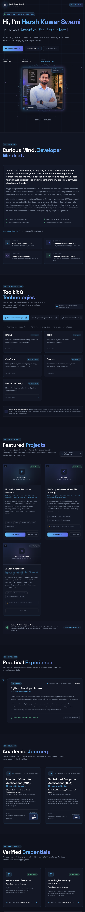

<div align="center">

# ⚡ Harsh Kuwar Swami — Premium Frontend Developer Portfolio

**Aspiring Frontend Developer · Web Developer · MCA (Information Technology)**  
*Aligarh, Uttar Pradesh, India*

[](https://harsh-portfolio-build.vercel.app/)
[](https://github.com/harshkuwarswami)
[](https://www.linkedin.com/in/Harsh-Kuwar-Swami-7a8848264/)
[](mailto:hkswami4@gmail.com)

</div>

---

## 🌟 Overview

Welcome to the personal portfolio of **Harsh Kuwar Swami**, an aspiring Frontend Developer based in Aligarh, Uttar Pradesh, India. Built with **React 18, TypeScript, Tailwind CSS, Three.js, React Three Fiber, and Vite**, this portfolio is designed to deliver a futuristic, high-performance, and cinematic experience demonstrating modern frontend engineering capabilities.

Every piece of information presented across this website is strictly fact-checked and verified from official educational credentials, real GitHub repositories, and verified LinkedIn records.

### Full-Page Preview

<details>
  <summary>View the portfolio screenshot</summary>
  <br />
  
</details>

---

## 🎨 Visual Identity & Design System

- **Aesthetic:** Futuristic & cinematic developer interface with deep glassmorphism and subtle developer-inspired grids.
- **Color Palette:**
  - **Background:** `#050816` (Deep space navy)
  - **Surface:** `#0B1224` (Subtle cyber surface)
  - **Primary:** `#38BDF8` (Electric Sky Cyan)
  - **Secondary:** `#6366F1` (Indigo Glow)
  - **Accent:** `#A78BFA` (Vibrant Violet)
  - **Text:** `#F8FAFC` (Pure Slate)
  - **Muted:** `#94A3B8` (Soft Slate)
- **Typography:** Space Grotesk & Inter for crisp editorial legibility.
- **Interactive 3D Experience:** Custom holographic geometry and orbital particle galaxy built with Three.js and React Three Fiber with automatic fallback for devices with reduced motion preferences or low-power profiles.

---

## 🛠️ Technology Stack

| Layer | Technologies |
| :--- | :--- |
| **Frontend Framework** | React 18, TypeScript, Vite |
| **Styling & Design System** | Tailwind CSS 3.4, Custom Glassmorphism, CSS Grid & Flexbox |
| **3D & Graphics** | Three.js, `@react-three/fiber`, `@react-three/drei` |
| **Animation & UI Polish** | Smooth typed typewriter effect, CSS keyframe animations, Canvas Confetti |
| **Icons & Typography** | Lucide React, Space Grotesk, Inter |
| **SEO & Standards** | Semantic HTML5, Schema.org JSON-LD (Person & WebSite), Open Graph, WCAG Contrast |

---

## 🚀 Verified Projects

### 1. 🍽️ [Urban Plate — Restaurant Website](https://urban-plate-restaurant.vercel.app/)
- **Repository:** [harshkuwarswami/urban-plate-restaurant](https://github.com/harshkuwarswami/urban-plate-restaurant)
- **Deployment Status:** **Live on Vercel**
- **Technologies:** React.js, Vite, JavaScript, CSS3
- **Functionality:** Responsive restaurant frontend featuring menu category filtering, food showcase gallery, and client-side reservation and contact forms.

### 2. 🔄 [NexDrop — Peer-to-Peer File Sharing](https://github.com/harshkuwarswami/NexDrop-Website)
- **Repository:** [harshkuwarswami/NexDrop-Website](https://github.com/harshkuwarswami/NexDrop-Website)
- **Deployment Status:** **Deployment Reported · URL Pending Addition**
- **Technologies:** JavaScript, Web Application, P2P Architecture
- **Description:** Web-based project focused on peer-to-peer file sharing and a modern file-transfer workflow. Source repository is private; visitors may not have public access.

### 3. 🎬 [AI Video Detector](https://github.com/harshkuwarswami/ai-video-detector)
- **Repository:** [harshkuwarswami/ai-video-detector](https://github.com/harshkuwarswami/ai-video-detector)
- **Deployment Status:** **Not Deployed (Python Standalone Project)**
- **Technologies:** Python, AI Video Analysis Concept
- **Description:** A Python-based software exploration investigating machine learning workflows and automated media processing fundamentals.

---

## 🎓 Education & Experience

### Education
- **Master of Computer Applications (MCA) — Information Technology**  
  *Aligarh College of Engineering & Technology, Aligarh*  
  Affiliated with: Dr. A.P.J. Abdul Kalam Technical University  
  Period: November 2024 – November 2026  
  Performance: **7.1 CGPA** *(Status: In Progress)*
  
- **Bachelor of Computer Applications (BCA)**  
  *Institute of Technology Management, Aligarh*  
  Affiliated with: Dr. Bhimrao Ambedkar University  
  Period: November 2021 – November 2023  
  Performance: **64%** *(Status: Completed)*

### Professional Experience
- **Python Developer Intern — Codec Technologies India**  
  *Internship · October 2025 – November 2025 (2 months)*  
  Completed a practical Python development internship focusing on foundational software scripting, programmatic problem solving, and development workflows. Verified completion credential on LinkedIn.

### Certifications
- **Generative AI Essentials** — Tata Consultancy Services *(Valid till September 2026)*
- **AI and Cybersecurity Awareness** — Tata Consultancy Services *(Valid till September 2026)*
- *Note: LinkedIn profile lists 6 total certifications. The remaining 4 will be updated here once their titles are verified.*

---

## 💻 Local Development

### Prerequisites
- Node.js (v18.0.0 or higher)
- npm or bun

### Setup Instructions

1. **Clone the repository:**
   ```bash
   git clone https://github.com/harshkuwarswami/harsh-frontend-portfolio.git
   cd harsh-frontend-portfolio
   ```

2. **Install dependencies:**
   ```bash
   npm install
   ```

3. **Start the local development server:**
   ```bash
   npm run dev
   ```
   Open [http://localhost:3000](http://localhost:3000) in your browser.

4. **Build for production:**
   ```bash
   npm run build
   ```
   The production-ready bundle will be generated in the `dist/` directory.

5. **Preview the production build locally:**
   ```bash
   npm run preview
   ```

---

## 🌐 Deployment Instructions

### Deploy to GitHub Pages

1. In `vite.config.ts`, verify `base: './'` (already configured for relative path portability).
2. Run `npm run build`.
3. Push the repository to GitHub under `harshkuwarswami/harsh-frontend-portfolio`.
4. In your GitHub repository:
   - Go to **Settings** → **Pages**.
   - Under **Build and deployment**, select **GitHub Actions** (using a standard Vite workflow) or deploy from the `gh-pages` branch using `dist`.

### Deploy to Vercel

1. Push your repository to GitHub.
2. Log into [Vercel](https://vercel.com) and click **Add New Project**.
3. Select your `harsh-frontend-portfolio` repository.
4. Framework Preset: **Vite** (auto-detected).
5. Click **Deploy**.

---

## 📁 Project Architecture

```
├── public/
│   ├── harsh-profile.png      # Original high-res verified portrait
│   └── favicon.svg
├── assets/
│   └── portfolio-preview.png  # Full-page portfolio screenshot
├── src/
│   ├── assets/                # Local project assets
│   ├── components/            # Reusable UI components
│   │   ├── 3d/
│   │   │   └── HeroScene.tsx  # Three.js / R3F interactive scene with CSS fallback
│   │   ├── CustomCursor.tsx   # Subtle custom pointer device cursor
│   │   ├── Footer.tsx         # Site footer with back-to-top & copyright
│   │   └── Navbar.tsx         # Glassmorphic header with active section tracking
│   ├── data/
│   │   └── portfolioData.ts   # Centralized typed data models for all facts
│   ├── sections/
│   │   ├── About.tsx          # Factual summary & quick info cards
│   │   ├── Certifications.tsx # TCS credentials & verified badges
│   │   ├── Contact.tsx        # Mailto composer, copy button & confetti
│   │   ├── Education.tsx      # MCA & BCA academic cards
│   │   ├── Experience.tsx     # Codec Technologies internship timeline
│   │   ├── Hero.tsx           # Full-screen cinematic hero with portrait & 3D
│   │   ├── Projects.tsx       # 3-column verified projects showcase
│   │   └── Skills.tsx         # Interactive categorized skill tiles
│   ├── styles/
│   │   └── index.css          # Tailwind directives, animations & glassmorphism
│   ├── types/
│   │   └── portfolio.ts       # Strict TypeScript interfaces
│   ├── App.tsx                # Main application component
│   └── main.tsx               # React root entry point
├── dist/                      # Standalone static distribution build
├── index.html                 # Production HTML with Schema.org & SEO meta
├── package.json               # Dependencies & build scripts
├── tailwind.config.js         # Custom color palette & fonts
├── tsconfig.json              # TypeScript compiler configuration
└── vite.config.ts             # Vite build & chunking configuration
```

---

## 📬 Contact & Connect

- **Email:** [hkswami4@gmail.com](mailto:hkswami4@gmail.com)
- **LinkedIn:** [linkedin.com/in/Harsh-Kuwar-Swami-7a8848264](https://www.linkedin.com/in/Harsh-Kuwar-Swami-7a8848264/)
- **GitHub:** [github.com/harshkuwarswami](https://github.com/harshkuwarswami)

---

<div align="center">
  <sub>Designed & Developed with precision for Harsh Kuwar Swami · 2026</sub>
</div>
# harsh-frontend-portfolio
